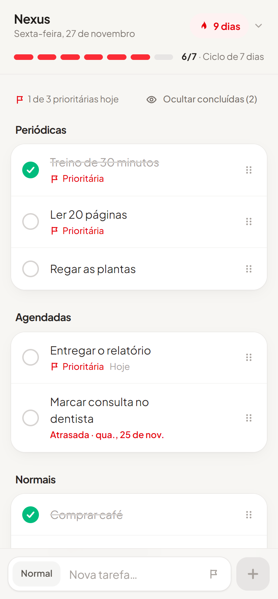

# Nexus

**Tarefas do dia e uma sequência que te mantém constante.**

O Nexus é um app de tarefas minimalista, pensado para o celular, com uma ideia central: separar o que é *importante fazer hoje* do resto, e transformar a constância em uma sequência de dias. Você marca o que é prioritário, conclui, e o medidor no topo avança — 3 dias de aquecimento e depois ciclos de 7.

🔗 **Acesse:** [nexusproductivity.com](https://nexusproductivity.com)

<p align="center">
  
</p>

## Funcionalidades

- **Quatro formas de agendar uma tarefa**
  - **Normal:** fica na lista até ser concluída.
  - **Periódica por dias da semana:** aparece só nos dias escolhidos (ex.: seg, qua, sex) e volta desmarcada no próximo dia em que se aplica.
  - **Periódica a cada X dias:** aparece a cada 2 a 30 dias a partir de uma data de início.
  - **Agendada:** aparece a partir de uma data e, se passar do dia sem ser concluída, é marcada como **atrasada**.
- **Prioridade:** qualquer tarefa pode ser prioritária. São as prioritárias que decidem se o dia conta para a sequência (veja a regra abaixo).
- **Sequência diária:** medidor de 3 dias de aquecimento seguido de ciclos de 7 dias, com estatísticas de sequência atual, recorde, ciclos completos e dias concluídos.
- **Funciona sem abrir todo dia:** ao abrir o app, todos os dias desde a última visita são avaliados.
- **Organização:** listas separadas (Periódicas, Agendadas, Normais), arrastar para reordenar, editar, ocultar concluídas.
- **PWA:** pode ser instalado na tela inicial do celular.
- **Privado por padrão:** tudo fica no `localStorage` do navegador. Sem conta, sem servidor, sem rastreamento.

## Regra do "dia feito"

A sequência é avaliada dia a dia, sempre na **data local** do usuário. Para cada dia:

1. **O dia tem tarefas prioritárias que se aplicam a ele?**
   - **Sim** → o dia só conta quando **todas** essas prioritárias forem concluídas naquele dia. As tarefas não prioritárias não ajudam nem atrapalham.
   - **Não** → o dia conta se **pelo menos uma tarefa** (de qualquer tipo) for concluída naquele dia.
2. **Se o dia não contou** (inclusive um dia sem nenhuma tarefa concluída) → a sequência **zera** e o medidor volta para 0/3.

Quando uma prioritária "se aplica" a um dia:

| Tipo | Se aplica ao dia quando… |
| --- | --- |
| Normal | sempre, enquanto não for concluída (pesa todo dia até ser feita) |
| Periódica (dias da semana) | o dia da semana está entre os escolhidos |
| Periódica (a cada X dias) | o dia cai no calendário fixo: início, início + X, início + 2X… |
| Agendada | a partir da data — inclusive enquanto estiver atrasada |

Detalhes que valem lembrar:

- **Dias sem abrir o app:** ao abrir, cada dia desde a última avaliação passa pela regra. Como nada foi concluído nos dias em que o app ficou fechado, esses dias zeram a sequência.
- **Periódica a cada X dias que não foi feita** não fica esperando: ela some, o dia zera (se for prioritária) e ela volta na próxima data do calendário.
- **Normais e agendadas concluídas** continuam riscadas até o fim do dia e são removidas na virada. Periódicas nunca são removidas, apenas voltam desmarcadas.
- **Hoje entra na prévia:** se o dia de hoje já está garantido, o medidor e a mensagem "Sequência garantida hoje" já mostram isso, mas o dia só é confirmado na virada.

A regra está em funções puras em [`src/lib/streak.ts`](src/lib/streak.ts) (`dayStatus` e `rollover`) e [`src/lib/schedule.ts`](src/lib/schedule.ts) (`appliesOn`), cobertas por testes.

## Stack

- [Next.js 16](https://nextjs.org) (App Router) + [React 19](https://react.dev)
- [TypeScript](https://www.typescriptlang.org)
- [Tailwind CSS 4](https://tailwindcss.com)
- [dnd-kit](https://dndkit.com) para arrastar e reordenar
- `node:test` para testes, rodando TypeScript direto no Node
- ESLint, [Husky](https://typicode.github.io/husky) e [lint-staged](https://github.com/lint-staged/lint-staged): cada commit passa por lint, checagem de tipos e testes

## Rodando localmente

Requer Node.js 24+ e [pnpm](https://pnpm.io).

```bash
pnpm install
pnpm dev        # http://localhost:3000
```

Outros comandos:

```bash
pnpm test       # testes (node --test)
pnpm lint       # ESLint
pnpm build      # build de produção
```

## Estrutura

```
src/
├── app/            # rotas, layout, manifest e ícones do PWA
├── components/     # interface (lista, formulário, medidor de progresso…)
└── lib/            # regras puras e testadas
    ├── dates.ts      # datas no fuso local
    ├── schedule.ts   # em que dias cada tarefa aparece
    ├── streak.ts     # regra do dia feito e sequência
    ├── tasks.ts      # criar, editar, concluir, reordenar
    └── storage.ts    # leitura, validação e migração do localStorage
```
